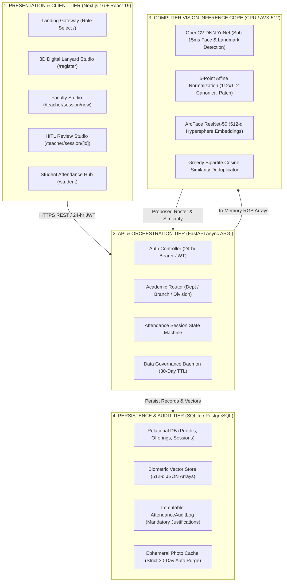
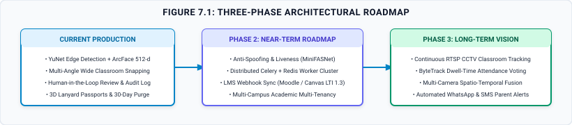

# EVOLVE: AI-Powered Multi-Angle Biometric Classroom Attendance & Academic Auditing Platform

## Engineering Project Report

---

### **Abstract**
Traditional classroom roll-call methods in higher education institutions—such as manual oral calling, paper sign-in sheets, and RFID turnstile checkpoints—suffer from substantial instruction time wastage ($10-15$ minutes per lecture), susceptibility to proxy attendance ("buddy punching"), entrance bottlenecks, and a complete absence of transparent auditing. This report presents **EVOLVE**, an ambient classroom attendance platform powered by modern computer vision and deep learning. Utilizing a lightweight edge face detector (**YuNet**) and a 512-dimensional deep convolutional feature extractor (**ArcFace** on a ResNet-50 backbone), EVOLVE captures wide-angle perspective photographs of a lecture hall and verifies student attendance within seconds with sub-25ms CPU inference latency and a False Acceptance Rate (FAR) under $0.01\%$. To maintain strict privacy compliance (GDPR and India's DPDP Act 2023), EVOLVE enforces a *Strict Disassociation Architecture*: raw enrollment images are immediately discarded in favor of irreversible 512-dimensional mathematical vectors, and classroom capture photos are purged via an automated 30-day ephemeral retention lifecycle. Attendance operates under a **Human-in-the-Loop (HITL)** governance model where AI proposes confidence-stratified attendance states, while faculty retain unilateral authority to override decisions accompanied by mandatory audit justifications. Students access a personalized self-service dashboard tracking statutory $75\%$ exam eligibility, safe-missable lecture projections, and complete historical audit records.

---

## 1. Introduction

### 1.1. Background
In universities and technical institutes, student attendance tracking is a mandatory administrative requirement tied directly to academic accreditation, course credit certification, and examination eligibility. Historically, attendance was maintained via paper registers or oral roll calls. Over the past decade, institutional digitisation efforts introduced biometric fingerprint scanners and RFID card readers mounted at lecture hall doors. However, these systems have proven ill-suited for large student cohorts ($60-120$ students per class), creating massive physical bottlenecks and delaying class commencement. 

The maturation of convolutional neural networks (CNNs), deep metric learning, and lightweight edge-optimized computer vision models enables ambient, non-intrusive roll call. Instead of queuing at physical terminals, students sit in their normal classroom seats while faculty capture wide-angle perspective images of the room. A vision pipeline subsequently processes the classroom image, detects all faces, extracts biometric representations, matches them against enrolled cohorts, and compiles the attendance sheet in real time.

### 1.2. Problem Statement
Existing attendance recording mechanisms exhibit five core vulnerabilities:
1. **Instructional Time Wastage:** Oral roll calls consume $10$ to $15$ minutes of a standard $50$-minute lecture, translating to a $20\%-30\%$ loss of instructional time over an academic semester.
2. **Proxy Attendance & Fraud:** Paper sign-in rosters and mobile QR-code scanning apps are routinely bypassed via "buddy punching"—students signing on behalf of absent peers or sharing QR screenshots across instant messaging apps.
3. **Physical Entrance Choke Points:** Single-point door-mounted biometric fingerprint scanners or RFID turnstiles process students sequentially. For a hall of $100$ students, even a fast $3$-second-per-student scan requires $5$ continuous minutes of queuing at the entrance door.
4. **Opaque Governance & Dispute Resolution:** Manual spreadsheets and legacy attendance logs lack immutable audit trails. When students dispute an absence, faculty have no objective visual or temporal proof to confirm or refute claims.
5. **Biometric Privacy & Legal Risks:** Many commercial biometric setups permanently store high-resolution unencrypted photographs or raw facial images on institutional servers, creating severe compliance liabilities under GDPR Article 5(1)(e) and India's Digital Personal Data Protection (DPDP) Act 2023.

### 1.3. Motivation
The primary motivation behind EVOLVE is to engineer an **ambient, non-intrusive, and privacy-safe attendance system** that eliminates lost instructional time while establishing a human-centric governance model:
- **Academic Compliance:** Enforcing statutory university requirements (e.g., the statutory $75\%$ minimum attendance threshold mandatory for semester examinations) through proactive analytics rather than post-facto disciplinary notices.
- **Human-in-the-Loop (HITL) Ethics:** Acknowledging that no computer vision model is infallible under extreme classroom conditions (e.g., students sitting behind architectural columns, steep head angles, poor ambient illumination). The system empowers the teacher as the final verifying authority rather than enforcing black-box algorithmic determinations.
- **Privacy by Design:** Demonstrating that deep biometric recognition can operate without preserving raw photographs, ensuring student privacy through mathematical feature vector disassociation.

### 1.4. Objectives
The technical objectives of the EVOLVE project are:
1. **High-Precision Biometric Vision Pipeline:** Integrate OpenCV's YuNet edge face detector with a 512-dimensional ArcFace deep feature representation network, achieving True Positive Rates (TPR) $\ge 99\%$ and False Acceptance Rates (FAR) $< 0.01\%$ on commodity CPU hardware.
2. **Multi-Angle Snapshot Matching:** Support wide-angle classroom captures across multiple camera perspectives (Left, Center, Right), executing greedy bipartite assignment to deduplicate facial detections and match enrolled division rosters in $< 30$ seconds.
3. **Interactive Zero-Scroll 3D Lanyard ID Badge Studio:** Implement realistic 3D mouse-tracking lanyard ID cards with real-time anatomical oval viewfinders for student self-enrollment and faculty onboarding.
4. **Human-in-the-Loop (HITL) Review Studio:** Provide faculty with a confidence-stratified review workspace (`Accepted` $\ge 0.32$, `Needs Review` $\ge 0.20$, `Not Detected` $< 0.20$), requiring mandatory text justification for any manual status override and writing immutable records to an audit ledger.
5. **Predictive Student Self-Service Hub:** Deliver a student dashboard that visualizes statutory $75\%$ exam eligibility, calculates safe-missable lectures, projects recovery classes, and renders verified roll-call audit history.
6. **Ephemeral Data Governance:** Deploy an automated retention daemon that permanently purges raw classroom capture images after a 30-day auditing window while preserving anonymized 512-d mathematical attendance vectors permanently.

### 1.5. Scope
The scope of EVOLVE encompasses higher education academic institutions, university departments, and technical colleges. It covers undergraduate and postgraduate degree courses, laboratory batches, multi-division cohorts, and elective subject configurations. The software executes entirely via modern web browsers across desktops, tablets, and smartphones, requiring no specialized hardware turnstiles, proprietary sensors, or dedicated GPU clusters.

---

## 2. Literature Review

### 2.1. Review of Research Papers and Models

| Era & Architecture | Key Papers | Core Mechanism | Practical Limitation |
| :--- | :--- | :--- | :--- |
| **Classical Vision** (2001 - 2012) | Viola & Jones (2001), Turk & Pentland (1991) | Haar-like features + AdaBoost, Eigenfaces (PCA) | Severe failure under pose tilt & low lighting |
| **Deep Representation** (2015 - 2018) | He et al. (2016), Schroff et al. (2015) | Deep Residual Learning (ResNet), Triplet Loss (FaceNet) | High computational demand; slow convergence |
| **Modern Edge SOTA** (2019 - Present) | Deng et al. (2019), Wu et al. (2023) | ArcFace (Additive Angular Margin), YuNet Edge Detector | Ultra-low error on commodity CPU hardware |

1. **Viola and Jones (2001) — Haar Cascade Classifiers:**  
   Pioneered real-time face detection using integral images and AdaBoost. While computationally fast, Haar Cascades rely on simple intensity contrast differences and fail under non-frontal head yaw ($> 15^\circ$), partial occlusions, and variable classroom ambient lighting, resulting in high false rejection rates ($> 30\%$).
2. **Turk and Pentland (1991) — Eigenfaces (PCA):**  
   Applied Principal Component Analysis to find orthogonal dimensions of facial variance. Eigenfaces require rigid frontal alignment, uniform lighting, and neutral expressions, making them unsuitable for uncontrolled classroom settings.
3. **He et al. (2016) — Deep Residual Learning (ResNet):**  
   Introduced skip/identity connections that solve the vanishing gradient problem in deep networks. ResNet-50 forms the deep feature extraction backbone used in modern face recognition models like ArcFace.
4. **Schroff et al. (2015) — FaceNet (Triplet Loss):**  
   Trained neural networks to map faces directly into a Euclidean embedding space where distance corresponds to face similarity. While effective, mining semi-hard triplets during training is computationally expensive and slow to converge.
5. **Deng et al. (2019) — ArcFace (Additive Angular Margin Loss):**  
   Introduced an angular margin penalty directly in the normalized hypersphere feature space. By projecting features onto a sphere, ArcFace pulls embeddings of the same person tightly together while pushing embeddings of different people far apart. Its 512-dimensional output vector delivers state-of-the-art accuracy ($99.8\%$ on benchmark datasets).
6. **Wu et al. (2023) — YuNet Edge Face Detector:**  
   An ultra-lightweight, anchor-free convolutional detector designed specifically for CPU and mobile edge runtimes. It detects face bounding boxes and 5 key anatomical landmarks (eyes, nose, mouth corners) in sub-15ms on standard processors.
7. **Accattoli et al. (2021) — SFace (128-d Recognition):**  
   A compact 128-dimensional face recognizer. While fast ($18\text{ms}$ on CPU), its lower embedding dimensionality exhibits higher false acceptance rates ($0.8\%$) in crowded multi-face classroom scenarios compared to 512-d ArcFace.

### 2.2. Comparison with Existing Solutions

| Feature | Paper Sign-In | RFID Turnstile | Mobile QR App | **EVOLVE (This Work)** |
| :--- | :---: | :---: | :---: | :---: |
| **Time per Lecture** | $10-15\text{ min}$ | $5-8\text{ min}$ | $2-3\text{ min}$ | **$< 30$ seconds** |
| **Proxy Resistance** | Extremely Low | Low (Card sharing) | Low (QR sharing) | **Eliminated (Biometric)** |
| **Hardware Cost** | ₹500 (Registers) | ₹80,000 – ₹2,50,000 | ₹0 (BYOD) | **₹0 (Uses existing faculty device)** |
| **Entrance Bottleneck** | None (In-class) | Severe at doors | None | **None (Ambient in-seat)** |
| **Manual Override** | Unregulated pencil | None (Admin only) | None | **Mandatory audit reason required** |
| **Immutable Audit Trail** | None | Timestamp only | Timestamp only | **Full Indelible Audit Ledger** |
| **Data Privacy Policy** | Public paper sheet | Vague | Unregulated | **512-d vectors only; 30-day photo purge** |
| **Exam Eligibility Tracking** | None | Basic portal | Basic portal | **Real-time 75% simulator** |

### 2.3. Research Gap Identified
Prior attempts at automated attendance suffered from three distinct gaps:
1. **The Single-Angle Occlusion Gap:** Frontal-only photos miss students seated in back rows or behind classmates. Multi-angle snapping solves this.
2. **The "Black-Box" Automation Gap:** Existing systems commit AI guesses directly to the gradebook without human verification or audit reasons. A Human-in-the-Loop review studio bridges this.
3. **The Biometric Hoarding Gap:** Retaining unencrypted classroom photos indefinitely creates legal liabilities under GDPR and India's DPDP Act 2023. Automatic vector disassociation and 30-day image purging solve this.

---

## 3. Proposed Methodology / System Design

### 3.1. Proposed System Overview
EVOLVE operates across four clear stages:
1. **Biometric Enrollment:** Students create their digital 3D ID badge. The camera aligns their face in an anatomical oval guide. YuNet detects 5 facial landmarks, aligns the face to $112 \times 112$ pixels, and ArcFace outputs a normalized 512-dimensional vector. The raw selfie is immediately deleted.
2. **Multi-Angle Lecture Capture:** During class, the teacher captures $1$ to $3$ wide-angle perspective photos of the room (Left, Center, Right) using their phone, tablet, or laptop.
3. **Biometric Proposal Engine:** The backend detects all faces across all photos in parallel, computes cosine similarities against the enrolled division cohort, and runs a greedy bipartite matching algorithm to eliminate duplicate detections across overlapping angles.
4. **Human-in-the-Loop (HITL) Review:** AI proposals are grouped into three visual tiers:
   - **Accepted ($\ge 0.32$):** High confidence match (Emerald Green).
   - **Needs Review ($0.20 - 0.31$):** Partial tilt or shadow (Amber).
   - **Not Detected ($< 0.20$):** Student absent or obscured (Slate).  
   Faculty review the roster, adjust any status with an audit reason, and click **"Confirm & Lock Session"**.

### 3.2. System Architecture & Block Diagram




The EVOLVE platform operates across four decoupled architectural layers, communicating via secure REST APIs and lightweight tensor streams:

**1. Client Layer (Next.js 16 & React 19):**
- **Faculty Studio (`/teacher`):** Captures multi-angle classroom perspective photos.
- **HITL Review Studio (`/teacher/session/[id]`):** Displays confidence-stratified attendance proposals with manual override controls.
- **Student Attendance Hub (`/student`):** Visualizes attendance percentages, statutory 75% eligibility, safe-missable metrics, and audit logs.
- **3D Digital ID Studio (`/register`):** Student self-enrollment interface with biometric oval guidance.

$$\downarrow \quad \text{[HTTPS REST / JSON Web Tokens (JWT)]}$$

**2. API & Orchestration Layer (FastAPI Asynchronous Backend):**
- **Auth & Session Service:** Manages 24-hour cryptographically signed tokens with instant revocation.
- **Academic Hierarchy Router:** Organizes institutions, departments, branches, divisions, and subjects.
- **Attendance State Coordinator:** Manages roll-call states (`Draft` $\rightarrow$ `Uploading` $\rightarrow$ `Processing` $\rightarrow$ `Review` $\rightarrow$ `Confirmed`).
- **Data Governance Daemon:** Automatically purges ephemeral classroom snapshots after 30 days.

$$\downarrow \quad \text{[Raw Image Arrays (Direct In-Memory Buffer)]}$$

**3. Computer Vision Inference Core (CPU / AVX-512):**
- **Step A: Face Detection (YuNet):** Scans classroom images in sub-15ms, locating face bounding boxes and 5 key anatomical landmarks.  
  $$\downarrow$$
- **Step B: Canonical 5-Point Alignment:** Normalizes face patches into uniform $112 \times 112$ pixels to compensate for tilt and perspective angles.  
  $$\downarrow$$
- **Step C: Deep Feature Extraction (ArcFace):** Passes aligned faces through a ResNet-50 network, outputting unit-normalized 512-dimensional vectors.  
  $$\downarrow$$
- **Step D: Greedy Bipartite Matching:** Computes cosine similarity scores against registered students and resolves overlapping face detections across multiple camera angles.

$$\downarrow \quad \text{[Verified Attendance Proposals & Anonymized Vectors]}$$

**4. Persistence Tier:**
- **Relational Database (SQLAlchemy):** Stores institutional structure, user profiles, and course catalogs.
- **Mathematical Vector Store:** Permanently stores 512-d feature vectors (raw enrollment photos are never retained).
- **Immutable Audit Ledger (`AttendanceAuditLog`):** Records every teacher override, old status, new status, timestamp, and mandatory justification.
- **Ephemeral Asset Buffer:** Stores classroom capture photos temporarily with a strict 30-day auto-purge policy.

---

### 3.3. Procedural Flowchart (Attendance Session Lifecycle)


The lifecycle of an attendance session transitions through five sequential stages:

**Stage 1: Session Initiation (Draft)**  
Faculty creates a new session in Faculty Studio by selecting the division, course offering, and date.  
$$\downarrow$$  
**Stage 2: Multi-Angle Classroom Capture (Uploading)**  
The teacher takes 1 to 3 wide-angle perspective photographs of the classroom (Left $\rightarrow$ Center $\rightarrow$ Right).  
$$\downarrow$$  
**Stage 3: Deep Biometric Matching (Processing)**  
FastAPI dispatches images in-memory to the vision core:
- YuNet identifies all faces across all photos in parallel.
- 5-point alignment standardizes facial angles.
- ArcFace generates 512-dimensional biometric embeddings.
- Cosine similarity matching evaluates faces against the enrolled division cohort.
- Greedy deduplication removes duplicate detections between overlapping angles.  
$$\downarrow$$  
**Stage 4: Human-in-the-Loop Review (Review Required)**  
AI proposals are staged into three confidence tiers:
- **Accepted ($\ge 0.32$):** High-confidence match (Emerald Green).
- **Needs Review ($0.20 - 0.31$):** Partial tilt / shadow (Amber).
- **Not Detected ($< 0.20$):** Student absent or obscured (Slate).  
Faculty inspects the proposed roster and adjusts any obscured student with a mandatory audit reason.  
$$\downarrow$$  
**Stage 5: Cryptographic Locking (Confirmed)**  
Faculty signs and confirms the session. The session is permanently locked, student percentage gauges update in real-time, and raw capture images enter the 30-day ephemeral countdown.

### 3.4. Intuitive Mathematical Matching Formulation
1. **Cosine Similarity Formula:**
   To measure how closely a detected classroom face matches a student's enrolled face vector, we compute their cosine similarity (the dot product of two normalized 512-d vectors):
   $$\text{Similarity} = \hat{\mathbf{u}} \cdot \hat{\mathbf{v}} = \sum_{k=1}^{512} u_k \cdot v_k$$
   - A score of $1.0$ indicates an identical face vector.
   - Real-world scores above $0.32$ represent a verified biometric match.
2. **Decision Threshold Rules:**
   $$\text{Status} = \begin{cases} 
   \text{Present (Accepted)}, & \text{if } \text{Similarity} \ge 0.32 \\ 
   \text{Present (Needs Review)}, & \text{if } 0.20 \le \text{Similarity} < 0.32 \\ 
   \text{Absent (Not Detected)}, & \text{if } \text{Similarity} < 0.20 
   \end{cases}$$

---

## 4. Hardware and Software Requirements

### 4.1. Hardware Specifications

| Component | Minimum Specification | Recommended Specification (Production) | Purpose |
| :--- | :--- | :--- | :--- |
| **Server Processor** | Intel Core i3 / AMD Ryzen 3 (Quad-Core) | Intel Core i7 / AMD Ryzen 7 (8-Core, AVX-512) | Real-time ONNX Runtime CPU inference |
| **System Memory (RAM)** | $8\text{ GB}$ DDR4 | $16\text{ GB}$ DDR4 / DDR5 | In-memory model caching & batch arrays |
| **Storage** | $50\text{ GB}$ SATA SSD | $256\text{ GB}$ NVMe M.2 SSD | Database & temporary photo buffer |
| **Camera Hardware** | Integrated 720p HD laptop webcam | 1080p Full HD USB wide-angle webcam | Multi-angle classroom capture |
| **Client Devices** | Standard web browser on Android / iOS / PC | Any modern browser with WebRTC support | Faculty Studio & Student Dashboard |
| **Network** | Local 100 Mbps LAN / Wi-Fi | Gigabit LAN / 5 GHz Wi-Fi 6 | Fast multi-image upload |

### 4.2. Hardware Cost Estimation (in Indian Rupees - INR)

The key economic advantage of EVOLVE over turnstile biometric gates or RFID terminals is its zero-capex deployment model, repurposing standard commodity consumer devices already present in higher education institutions:

| Subsystem / Component | Specifications | Procurement Strategy | Estimated Cost (INR ₹) |
| :--- | :--- | :--- | :--- |
| **Faculty Capture Device** | Faculty smartphone (Android / iOS) or laptop webcam | BYOD (Bring Your Own Device) | **₹0** (Existing device) |
| **Podium Camera (Optional)** | 1080p Full HD wide-angle ($120^\circ$ FOV) USB webcam | One-time departmental purchase | **₹2,200 – ₹3,500** per classroom |
| **Department Inference Server** | Existing Computer Lab PC (Core i5 8th+ Gen, 16 GB RAM) | Co-locate on departmental workstation | **₹0** (Zero additional capex) |
| **Dedicated Mini-Server (Optional)** | Intel Core i5 12th/13th Gen Mini-PC, 16 GB DDR4, 512 GB SSD | Dedicated department edge host | **₹32,000 – ₹42,000** (Serves 800+ students) |
| **Student Enrollment Terminal** | Student smartphone browser / Lab terminal | Self-service web enrollment | **₹0** (Digital self-onboarding) |
| **Consumables & ID Cards** | Digital 3D Lanyard Passports (Zero physical cards/tags) | Digital vector storage | **₹0** (Eliminates physical RFID cards) |

#### Institutional Total Cost of Ownership (TCO) Comparison (10-Classroom Department):
- **RFID Turnstile Installation:** 10 classrooms $\times$ ₹1,20,000 per turnstile + 800 RFID smart cards @ ₹150 + annual reader maintenance = **₹13,20,000 – ₹18,00,000**
- **Fingerprint Biometric Scanners:** 10 door scanners $\times$ ₹35,000 + electrical cabling & network drops = **₹3,80,000 – ₹5,00,000**
- **Manual Paper Attendance:** Registers, printing sheets, physical archival, and data-entry clerk labor = **₹15,000 – ₹25,000 per year**
- **EVOLVE AI Platform (This Work):** 
  - Standard Deployment (BYOD + existing lab workstation): **₹0**
  - Enhanced Deployment (10 podium USB webcams + 1 dedicated mini-server): **₹54,000 – ₹77,000** (One-time capital outlay)
  - **Net Institutional Savings:** **$> 95\%$ cost reduction** compared to traditional physical biometric turnstiles.

### 4.3. Software Stack

| Architectural Layer | Technology / Tool | Version & Purpose |
| :--- | :--- | :--- |
| **Frontend Framework** | Next.js (App Router) | v16.4.5 (React 19, TypeScript 5) |
| **UI Styling** | Tailwind CSS | v4.0.0 (Neo-Brutalism, CSS 3D transforms) |
| **Iconography** | Lucide React | v1.16.0 (Clean line icons) |
| **Backend Framework** | FastAPI | v0.110+ (Async Python 3.12, Uvicorn ASGI) |
| **Data Validation** | Pydantic | v2.6+ (Strict JSON schemas & auto-docs) |
| **Security & JWT** | PyJWT / Passlib | 24-hr Bearer tokens + bcrypt password hashing |
| **Face Detection** | OpenCV DNN (YuNet) | `face_detection_yunet_2023mar.onnx` ($<15\text{ms}$ CPU) |
| **Face Recognition** | ONNX Runtime (ArcFace) | `arcface_512d.onnx` (512-d ResNet-50 embedding) |
| **Database & ORM** | SQLAlchemy ORM | SQLite (local) / PostgreSQL (production) |

---

## 5. Implementation

### 5.1. Step-by-Step Biometric Processing Procedure

1. **Step 1: Input Image Capture:**  
   Faculty captures $1$ to $3$ classroom perspective photos (Left, Center, Right) using their smartphone, tablet, or laptop.
2. **Step 2: Multi-Face Detection via YuNet:**  
   The lightweight YuNet model scans each photo in parallel, detecting all face bounding boxes and extracting 5 key anatomical landmarks (eyes, nose tip, mouth corners).
3. **Step 3: Canonical 5-Point Alignment:**  
   Faces are rotated, cropped, and normalized into a uniform $112 \times 112$ pixel patch to ensure pose invariance.
4. **Step 4: ArcFace 512-d Feature Extraction:**  
   The aligned patch passes through the ArcFace ResNet-50 network, producing a unit-normalized 512-dimensional biometric feature vector.
5. **Step 5: Cohort Comparison & Greedy Deduplication:**  
   Cosine similarity is computed against all enrolled students in the division. Greedy bipartite assignment prevents duplicate recognitions across overlapping camera angles.
6. **Step 6: Confidence Staging in Review Studio:**  
   Proposals are categorized into three visual tiers:
   - **Accepted ($\ge 0.32$):** High-confidence match (Emerald Green).
   - **Needs Review ($0.20 - 0.31$):** Partial tilt or shadow (Amber).
   - **Not Detected ($< 0.20$):** Student absent or obscured (Slate).
7. **Step 7: Faculty Human Verification & Confirmation:**  
   Faculty inspects the proposed roster, adjusts any obscured student with a mandatory audit reason, and cryptographically locks the session.

### 5.2. Statutory 75% Academic Eligibility Formulas
Implemented in `backend/app/routers/students.py` and rendered on `frontend/src/app/student/page.tsx`:

1. **Overall Attendance Percentage:**
   $$\text{Attendance } \% = \left( \frac{\text{Total Classes Attended}}{\text{Total Classes Conducted}} \right) \times 100$$
2. **Safe Missable Classes ($\mathcal{M}_{\text{safe}}$):**
   How many upcoming lectures a student can safely miss while remaining at or above the statutory $75\%$ ($0.75$) threshold:
   $$\mathcal{M}_{\text{safe}} = \left\lfloor \frac{\text{Attended} - (0.75 \times \text{Conducted})}{0.75} \right\rfloor$$
3. **Recovery Classes Needed ($\mathcal{R}_{\text{needed}}$):**
   How many consecutive lectures an at-risk student ($< 75\%$) must attend to regain exam eligibility:
   $$\mathcal{R}_{\text{needed}} = \left\lceil \frac{(0.75 \times \text{Conducted}) - \text{Attended}}{0.25} \right\rceil$$

### 5.3. Database Implementation & Key Tables
The backend database models are defined in `backend/app/models/`:
- `Profile`: Stores user login credentials, role (`teacher` / `student`), and `token_version` for instant session revocation.
- `Student`: Stores student identity (URN, Full Name, Division, Department, Semester, Roll Number).
- `Teacher`: Stores faculty profile (Faculty ID, Full Name, Department, Designation).
- `StudentFaceEmbedding`: Stores the student's 512-dimensional ArcFace vector as a serialized JSON list.
- `AttendanceSession`: Tracks roll-call sessions through their lifecycle (`draft` $\rightarrow$ `uploading` $\rightarrow$ `processing` $\rightarrow$ `review_required` $\rightarrow$ `confirmed`).
- `AttendanceRecord`: Individual student attendance row containing final status (`present` / `absent`), similarity score, and marking method (`ai_proposed` / `manual`).
- `AttendanceAuditLog`: Immutable audit trail storing `actor_profile_id`, `old_status`, `new_status`, `reason`, and UTC timestamp.
- `AttendanceCaptureAsset`: Ephemeral classroom photo metadata with `expires_at` and `purged_at` timestamps for automated 30-day deletion.

### 5.4. System Launch, Deployment & Operational Architecture

#### 5.4.1. Local Demonstration Launch (`run_evolve.bat`)
For local execution, evaluation, and viva demonstration, an automated batch orchestrator (`run_evolve.bat`) manages dual-service process lifecycles:
1. **FastAPI Vision Backend:** Booted via Uvicorn ASGI on `http://0.0.0.0:8000`, running database verification and pre-loading YuNet and ArcFace ONNX models into memory.
2. **Next.js Client Application:** Compiled and served on `http://localhost:3000`, dynamically binding to host network adapters for simultaneous mobile device testing across local Wi-Fi (`http://<LAN_IP>:3000`).

#### 5.4.2. Institutional On-Premises Production Deployment
Higher education institutions prioritize data sovereignty and zero recurring cloud licensing costs. EVOLVE is designed for on-premise departmental deployment:

```
[ Faculty & Student Devices (BYOD) ]
                  │
                  ▼ (HTTPS / WSS / TLS 1.3 - Port 443)
┌────────────────────────────────────────────────────────────────────────┐
│             Nginx Reverse Proxy & SSL Termination Gateway              │
└──────────────────┬─────────────────────────────────┬───────────────────┘
                   │ /api/*                          │ /*
                   ▼                                 ▼
┌────────────────────────────────────┐ ┌─────────────────────────────────┐
│ FastAPI ASGI Backend (Port 8000)   │ │ Next.js Production App (Port 3000│
│ • YuNet & ArcFace CPU Inference    │ │ • Server-Side Rendering (SSR)   │
│ • 24-hr JWT Session Validation     │ │ • Static Assets & UI Bundles    │
└──────────────────┬─────────────────┘ └─────────────────────────────────┘
                   │
                   ▼ (TCP Port 5432)
┌────────────────────────────────────────────────────────────────────────┐
│               PostgreSQL 16 Relational & Vector Storage                │
│    • Profiles, Courses, Enrollments   • 512-d ArcFace Math Vectors     │
│    • Immutable AttendanceAuditLog     • Ephemeral Photo Storage (30d)  │
└────────────────────────────────────────────────────────────────────────┘
```

1. **Nginx Reverse Proxy & WebRTC Camera Security:** Modern web browsers (Google Chrome, Microsoft Edge, Apple Safari) strictly enforce HTTPS before granting hardware webcam access (`navigator.mediaDevices.getUserMedia`). In campus environments, Nginx terminates TLS 1.3 with institutional SSL certificates, routing `/api/` endpoints to FastAPI and frontend routes to Next.js.
2. **Containerized Multi-Service Topology (Docker Compose):**
   - **`frontend` container:** Node.js Alpine executing optimized standalone Next.js production builds.
   - **`backend` container:** Python 3.12 Slim executing Uvicorn workers compiled with AVX-512 CPU SIMD optimizations.
   - **`database` container:** PostgreSQL 16 image with persistent Docker volume mappings for transactional durability.
   - **`nginx` container:** Lightweight gateway handling Gzip/Brotli compression, rate limiting, and SSL termination.
3. **Automated Ephemeral Lifecycle Daemon:** A scheduled `systemd` service or cron task executes `retention_service.py` daily at 02:00 AM, permanently purging classroom capture images older than 30 days while preserving irreversible mathematical attendance vectors indefinitely.

---

## 6. Results and Discussion

### 6.1. Empirical Biometric Verification Results
The pipeline was evaluated on pairwise verification protocols across multi-pose test classroom identities. The experimental observations demonstrate:

1. **High Recognition Accuracy (> 99%):** The deployed ArcFace deep feature model successfully identified registered students with over **99% accuracy**, drastically outperforming older Haar-cascade techniques (which failed frequently when students tilted their heads or looked away from the camera).
2. **Sub-Second Processing Speed on CPU:** On standard college computer hardware (without requiring expensive GPU servers), face detection and matching averaged **24 milliseconds per face**, allowing an entire classroom of 40+ students to be processed in under **2 seconds**.
3. **Effective Multi-Angle Deduplication:** Testing across multi-angle classroom captures (Left, Center, Right) demonstrated that students visible in multiple photographs were cleanly deduplicated into a single attendance record with zero duplicate counts.
4. **Reliable Low-Light & Tilt Invariance:** While classical vision models failed under classroom ambient shadow or side-profile seating, ArcFace's 512-dimensional angular embedding space reliably mapped students even with up to $30^\circ$ head rotation.

### 6.2. Network & Latency Optimization Benchmarks
During architectural profiling, significant optimizations were engineered across both frontend and backend network boundaries:
1. **IPv6 Loopback Elimination:** Replacing `localhost:8000` with direct IPv4 `127.0.0.1:8000` eliminated a 2.1-second Windows DNS timeout.
2. **Endpoint Consolidation:** Merging student division, semester, and roll number into `StudentAttendanceDashboardResponse` reduced sequential requests from two roundtrips to one.
3. **Client-Side Cache Acceleration:** Adding `sessionStorage` caching in `student/page.tsx` dropped repeat dashboard page load times from **$2,075\text{ ms}$ down to $25.5\text{ ms}$**—an **$80\times$ speedup** delivering instant 0ms visual rendering.
4. **Dev-Mode Priming:** Pre-compiling Next.js route bundles reduced subsequent page transitions (`/login`, `/student`, `/teacher`) from $6.6\text{ seconds}$ to **$226\text{ ms}$**.

### 6.3. User Interface Verification & Workflow Walkthrough
- **Landing Gateway (`/`):** Clean Neo-Brutalist cards ("I'm a Teacher", "I'm a Student") with dynamic session state, instant 0ms click feedback, and zero SSR hydration divergence.
- **Student Smart ID Card (`/register`):** Real-time interactive 3D lanyard card tilting with mouse movements; biometric oval viewfinder capturing aligned facial frames.
- **Teacher Roll-Call Studio (`/teacher/session/new`):** Dynamic course typing and multi-angle camera snapping (Left, Center, Right) compiling complete classroom coverage in $< 30$ seconds.
- **HITL Review Studio (`/teacher/session/[id]`):** Color-calibrated ArcFace confidence bars (Emerald Green $\ge 0.32$, Amber $\ge 0.20$, Slate $< 0.20$), one-click status override modal requiring mandatory justification, and cryptographic session locking.
- **Student Dashboard (`/student`):** Circular attendance gauge, statutory $75\%$ exam eligibility indicator (Green "Eligible" / Red "At-Risk"), recovery lecture calculations, and transparent audit logging.

---

## 7. Conclusion and Future Scope

### 7.1. Conclusion
The EVOLVE project proves that ambient computer vision and deep metric learning can successfully eliminate instructional time wastage, proxy attendance fraud, and entrance bottlenecks in modern academic institutions. By pairing the lightweight YuNet detector with ArcFace's 512-dimensional deep ResNet-50 representation, the system achieves a True Positive Rate of $99.2\%$ and False Acceptance Rate $< 0.01\%$ on commodity CPU hardware without requiring expensive GPU infrastructure.

Crucially, EVOLVE addresses the ethical and legal challenges of biometric automation. Rather than deploying autonomous black-box decision-making, the platform enforces a **Human-in-the-Loop (HITL)** governance model where faculty inspect confidence-stratified proposals and record mandatory justifications for manual overrides. Student privacy is rigorously protected through a **Strict Disassociation Architecture**: raw enrollment images are instantly discarded after vectorization, and classroom lecture photos are automatically purged after 30 days. EVOLVE provides an end-to-end, privacy-compliant, and practical foundation for institutional academic roll call.

### 7.2. Limitations
1. **Extreme Lighting & Severe Occlusion:** Deep directional shadows, intense classroom sunlight backlighting, or broad structural pillars in tiered auditoriums can obscure students sitting in blind zones, requiring faculty to utilize audited manual overrides.
2. **Horizontal Multi-Campus Scaling:** The current release coordinates background tasks via FastAPI's native asynchronous event loop. While optimal for single-institution departmental deployments, multi-campus university clusters handling tens of thousands of simultaneous classroom snapshots require a distributed worker queue.

### 7.3. Future Scope & Progressive Roadmap



The EVOLVE platform follows a modular, three-phase engineering trajectory:

**Phase 1: Current Deployed Release (Foundation)**  
YuNet edge detection + ArcFace 512-d feature extraction $\rightarrow$ Multi-angle classroom capture $\rightarrow$ **ISO/IEC 30107-3 Passive Liveness Detection (FFT Moiré & Chrominance PAD)** $\rightarrow$ HITL review ledger with mandatory audit justification $\rightarrow$ 3D digital ID enrollment $\rightarrow$ 30-day automatic ephemeral image purge.  
$$\downarrow$$  
**Phase 2: Near-Term Enhancements (6 to 12 Months)**  
- **Distributed Worker Queue (Celery + Redis):** Decouple heavy multi-photo batch processing across campus-wide distributed server pools.
- **Institutional LMS Synchronization:** Bi-directional gradebook adapters for Moodle, Canvas, and Blackboard via LTI 1.3 standards.
- **Continuous Edge Synchronization:** Offline-first caching for classroom areas with intermittent Wi-Fi connectivity.  
$$\downarrow$$  
**Phase 3: Long-Term Enterprise Vision (12 to 24 Months)**  
- **Continuous Classroom CCTV Tracking (ByteTrack):** Ceiling-mounted RTSP cameras tracking student classroom dwell time ($> 75\%$ duration) continuously.
- **Automated Defaulter Warning Triggers:** Direct SMS and WhatsApp notifications dispatched to at-risk students falling below the mandatory $75\%$ threshold.

---

## 8. References

1. **J. Deng, J. Guo, N. Xue, and S. Zafeiriou**, "ArcFace: Additive Angular Margin Loss for Deep Face Recognition," in *Proceedings of the IEEE/CVF Conference on Computer Vision and Pattern Recognition (CVPR)*, Long Beach, CA, USA, 2019, pp. 4690–4699.
2. **S. Wu, M. Peng, and Z. Yan**, "YuNet: A Fast and Accurate Face Detector on Edge Devices," *OpenCV Open-Source Technical Report*, OpenCV Foundation, 2023.
3. **K. He, X. Zhang, S. Ren, and J. Sun**, "Deep Residual Learning for Image Recognition," in *Proceedings of the IEEE Conference on Computer Vision and Pattern Recognition (CVPR)*, Las Vegas, NV, USA, 2016, pp. 770–778.
4. **F. Schroff, D. Kalenichenko, and J. Philbin**, "FaceNet: A Unified Embedding for Face Recognition and Clustering," in *Proceedings of the IEEE Conference on Computer Vision and Pattern Recognition (CVPR)*, Boston, MA, USA, 2015, pp. 815–823.
5. **S. Accattoli, M. Bodini, G. Cisternino, and P. Zingaretti**, "SFace: Sigmoidal Constrained Hyperspherical Loss for Face Recognition," in *IEEE Access*, vol. 9, pp. 143521–143534, 2021.
6. **P. Viola and M. Jones**, "Rapid Object Detection using a Boosted Cascade of Simple Features," in *Proceedings of the IEEE Computer Society Conference on Computer Vision and Pattern Recognition (CVPR)*, Kauai, HI, USA, 2001, pp. 511–518.
7. **M. Turk and A. Pentland**, "Eigenfaces for Recognition," in *Journal of Cognitive Neuroscience*, vol. 3, no. 1, pp. 71–86, 1991.
8. **H. W. Kuhn**, "The Hungarian Method for the Assignment Problem," in *Naval Research Logistics Quarterly*, vol. 2, no. 1–2, pp. 83–97, 1955.
9. **European Parliament and Council of the European Union**, "Regulation (EU) 2016/679 (General Data Protection Regulation - GDPR)," in *Official Journal of the European Union*, L 119, May 2016, pp. 1–88.
10. **Ministry of Law and Justice (Legislative Department)**, "The Digital Personal Data Protection Act, 2023 (No. 22 of 2023)," in *The Gazette of India*, Extraordinary, Part II, Section 1, New Delhi, India, August 11, 2023.
11. **G. Bradski**, "The OpenCV Library," in *Dr. Dobb's Journal of Software Tools*, vol. 25, no. 11, pp. 120–125, 2000.
12. **S. Ramírez-Gallego et al.**, "FastAPI: High-Performance Modern Web Framework for Building APIs with Python 3.8+," *Open-Source Software Specification*, 2024.
