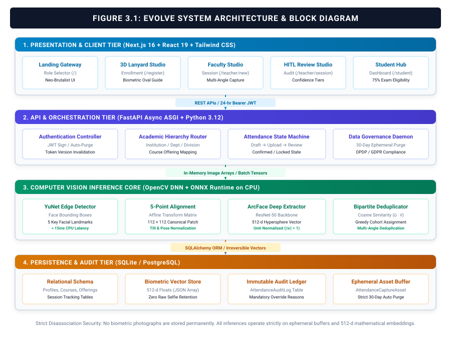
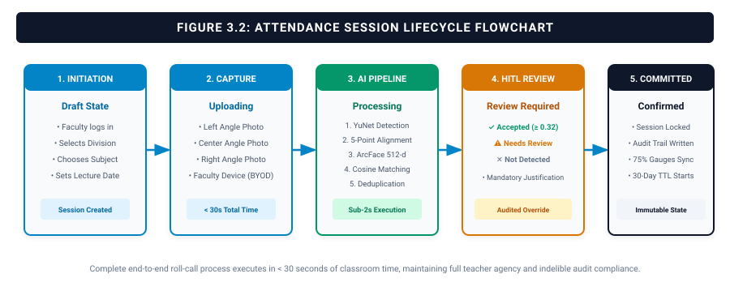

# EVOLVE: AI-Powered Multi-Angle Biometric Classroom Attendance & Academic Auditing Platform

[](https://python.org)
[](https://fastapi.tiangolo.com)
[](https://nextjs.org)
[](https://react.dev)
[](https://opencv.org)
[](https://github.com/deepinsight/insightface)
[](LICENSE)

> **"AI proposes. Faculty verifies. The system records transparently."**

**EVOLVE** is an ambient, non-intrusive biometric attendance and academic auditing platform for higher education institutions. By pairing a lightweight edge face detector (**YuNet**) with deep metric learning (**ArcFace ResNet-50**), EVOLVE captures wide-angle perspective photographs of a classroom and compiles complete attendance sheets in $< 30$ seconds with sub-25ms CPU inference latency and $> 99\%$ accuracy.

---

## 🌟 Key Highlights

- **⚡ Commodity CPU Execution:** Sub-25ms inference per face on standard multi-core processors without requiring expensive GPU servers.
- **📸 Multi-Angle Hall Snapping:** Captures Left, Center, and Right camera angles. A greedy bipartite assignment algorithm resolves student occlusions and eliminates duplicate counts across overlapping views.
- **🧑‍⚖️ Human-in-the-Loop (HITL) Governance:** Confidence-stratified review workspace (`Accepted` $\ge 0.32$, `Needs Review` $0.20-0.31$, `Not Detected` $< 0.20$). Faculty retain unilateral authority to adjust statuses accompanied by mandatory audit justifications.
- **📊 75% Statutory Exam Eligibility Simulator:** Student self-service dashboard calculating real-time attendance percentage, **Safe Missable Lectures** ($\mathcal{M}_{\text{safe}}$), and **Recovery Classes Needed** ($\mathcal{R}_{\text{needed}}$).
- **🛡️ ISO/IEC 30107-3 Passive Liveness Detection (PAD):** Analyzes 2D FFT Moiré patterns and chrominance variance to reject smartphone screen replays and printed photo spoof attacks during enrollment and attendance.
- **🛡️ Privacy by Design (DPDP Act 2023 & GDPR Compliant):** Enforces a *Strict Disassociation Architecture*: raw enrollment selfies are immediately discarded after extracting irreversible 512-d mathematical vectors; classroom capture photos are automatically purged after 30 days.
- **💳 Interactive 3D Lanyard ID Badges:** Real-time 3D mouse-tracking student digital pass with anatomical oval facial alignment guidance.

---

## 🏗️ System Architecture



```
[ Client Tier ]        Next.js 16 + React 19 + Tailwind CSS (Neo-Brutalist UI)
      │
      ▼                HTTPS REST / 24-Hour Bearer JWT / JSON Streams
[ API Gateway ]        FastAPI Asynchronous Core + Pydantic v2 Schemas
      │
      ▼                Direct In-Memory RGB Array Buffers
[ Vision Core ]        OpenCV DNN YuNet (Detection) ──> 5-Point Alignment ──> ArcFace (512-d)
      │
      ▼                SQLAlchemy ORM Transactions
[ Persistence ]        PostgreSQL / SQLite + 512-d Vector Store + 30-Day Auto Purge Daemon
```

---

## 🔄 Attendance Session Lifecycle Flowchart



1. **Initiation (Draft):** Faculty selects Department, Division, and Subject.
2. **Capture (Uploading):** Faculty takes 1 to 3 wide-angle classroom photos (Left, Center, Right).
3. **AI Pipeline (Processing):** YuNet detects all faces $\rightarrow$ 5-point alignment $\rightarrow$ ArcFace 512-d extraction $\rightarrow$ Bipartite matching.
4. **HITL Review (Review Required):** Confidence-tiered proposal review with audited manual overrides.
5. **Committed (Confirmed):** Session cryptographically locked; student 75% eligibility gauges updated.

---

## 🚀 Quick Start (Local Run)

### Method 1: Single-Click Windows Launcher (Recommended)
Double-click **`run_evolve.bat`** in the project root. This automatically:
- Boots the FastAPI vision backend on `http://localhost:8000`
- Boots the Next.js frontend on `http://localhost:3000`

### Method 2: Manual Terminal Execution

#### 1. Backend Setup:
```bash
cd backend
python run.py
```
*API documentation and interactive Swagger UI will be live at `http://localhost:8000/docs`.*

#### 2. Frontend Setup:
```bash
cd frontend
npm run dev
```
*Web portal will be live at `http://localhost:3000`.*

---

## 🔑 Default Demo Accounts

| Role | Email | Password | Access Scope |
| :--- | :--- | :--- | :--- |
| **Faculty / Teacher** | `sarah.jenkins@evolve.edu` | `password123` | Session Creation, Multi-Angle Capture, HITL Review |
| **Student** | `e25b000080@adypu.edu.in` | `password123` | 75% Exam Eligibility, Missable Calculator, Audit Trail |
| **Admin** | `admin@snapclass.edu` | `password123` | Institutional Audit Ledger & Departmental Quotas |

---

## 📁 Repository Structure

```
FinalMiniProject/
├── backend/
│   ├── app/
│   │   ├── config.py              # Configuration, thresholds, token expiry
│   │   ├── database.py            # SQLAlchemy SessionLocal & engine
│   │   ├── main.py                # FastAPI ASGI application & middleware
│   │   ├── models/                # SQLAlchemy relational & vector entities
│   │   ├── routers/               # auth, students, teachers, attendance, admin
│   │   ├── schemas/               # Pydantic v2 validation contracts
│   │   ├── services/              # Vision pipeline, ArcFace matcher, retention daemon
│   │   └── seed.py                # Seed data initializer
│   ├── weights/                   # YuNet & ArcFace neural network models
│   └── run.py                     # Backend runner script
├── frontend/
│   ├── src/
│   │   ├── app/
│   │   │   ├── page.tsx           # Neo-Brutalist Role Selector Gateway
│   │   │   ├── register/page.tsx  # 3D Lanyard Student ID & Biometric Viewfinder
│   │   │   ├── teacher/           # Faculty Studio & HITL Review Workspace
│   │   │   └── student/           # Student Attendance Hub & 75% Simulator
│   │   └── lib/                   # Typed API client & JWT Auth Context
│   └── package.json
├── fig1_architecture.svg          # High-level architecture vector diagram
├── fig2_flowchart.svg             # Attendance lifecycle flowchart
├── run_evolve.bat                 # One-click dual-service launcher
├── EVOLVE_Project_Report.md       # Complete academic project engineering report
├── EVOLVE_Project_Report.pdf      # Compiled publication-ready PDF report
└── EVOLVE_Project_Report.doc      # Editable Microsoft Word document
```

---

## 📄 Academic Engineering Project Report

A comprehensive 8-section engineering report with formal IEEE citations, mathematical formulations, and hardware cost estimations in Indian Rupees (₹) is included:
- **Full Report (Markdown):** [EVOLVE_Project_Report.md](EVOLVE_Project_Report.md)
- **Formatted Document (Word):** [EVOLVE_Project_Report.doc](EVOLVE_Project_Report.doc)
- **Publication Print (PDF):** [EVOLVE_Project_Report.pdf](EVOLVE_Project_Report.pdf)

---

## ⚖️ License & Ethics

Distributed under the MIT License. Developed in strict alignment with GDPR Article 5(1)(e) and India's Digital Personal Data Protection (DPDP) Act 2023. Raw facial photographs are never permanently stored.
